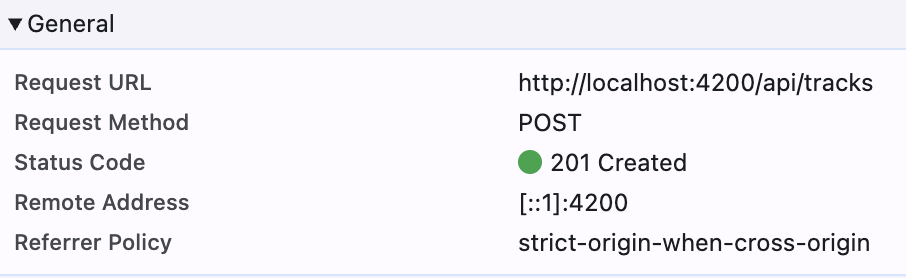
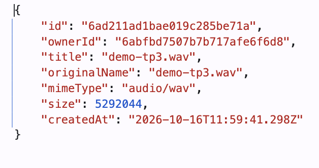
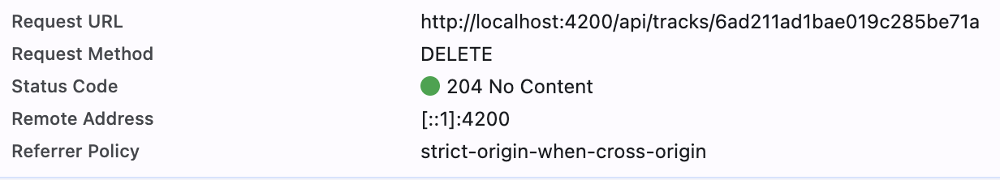

# Livrables TP3 - Suppression, progression d'upload et tests

Vérifications faites avec les tests automatisés, `curl` sur l'API lancée en local (`http://localhost:3000`) et l'interface servie par `http://localhost:4200` (proxy Angular). Le JWT et les mots de passe ne sont jamais recopiés ici.

## 1. Mission 5 - Suppression d'une piste

Flux : bouton « Supprimer » de `TrackCardComponent` → `(remove)` → `TracksPageComponent.remove(track)` → `TrackService.delete(id)` → `HttpClient.delete('/api/tracks/:id')` → `authInterceptor` ajoute le JWT → `DELETE /api/tracks/:id` → `204 No Content`.

| Exigence | Où |
| --- | --- |
| Action « Supprimer » dans chaque card (`output remove`, `aria-label`) | [track-card.html](frontend-starter/src/app/components/track-card/track-card.html), [track-card.ts](frontend-starter/src/app/components/track-card/track-card.ts) |
| Appel HTTP uniquement dans le service | `TrackService.delete()` dans [track.service.ts](frontend-starter/src/app/shared/services/track.service.ts) |
| Confirmation avant suppression | `window.confirm(...)` au début de `remove()` dans [tracks-page.ts](frontend-starter/src/app/components/tracks-page/tracks-page.ts). Si l'utilisateur annule, aucune requête ne part. |
| État de suppression contre les doubles clics | Signal `deletingTrackId` : garde `if (this.deletingTrackId()) return`, et l'input `deleting` désactive les boutons de la card (« Suppression… ») |
| Message de succès ou d'erreur | `MatSnackBar.open()` (Angular Material) |
| Mise à jour de la page | `afterDelete()` : recharge la page courante, recule d'une page si on supprime la dernière piste d'une page > 1, arrête la lecture et révoque l'`ObjectURL` si la piste supprimée était en cours d'écoute |
| Piste supprimée entre-temps ou appartenant à un autre utilisateur | Le backend répond `404 Piste inconnue` → SnackBar « … n'existe plus ou ne vous appartient pas. La liste a été actualisée. » puis rechargement de la liste |
| Autres erreurs | `0` serveur injoignable, `401` session expirée (l'intercepteur déconnecte et redirige vers `/login`), `500` métadonnée supprimée mais fichier non supprimé (message du backend + rechargement) |

### Pourquoi la suppression passe par un service

Le composant gère l'affichage et les états (confirmation, bouton désactivé, message). Le service connaît l'URL et la méthode HTTP. Le même `delete()` peut donc être réutilisé ailleurs, et on peut le tester sans afficher de composant. Dans les tests du composant, on vérifie aussi que c'est bien la requête `DELETE /api/tracks/:id` qui part.

### Pourquoi le guard et l'interface ne suffisent pas

`authGuard` et le bouton « Supprimer » ne s'exécutent que dans le navigateur. N'importe qui peut envoyer `DELETE /api/tracks/<id>` avec `curl`, depuis les DevTools ou avec un client modifié, sans jamais passer par Angular. Le guard ne fait que masquer une page, et il ne vérifie que la présence d'un token, pas sa validité.

La vraie protection est dans [backend/src/app.js](backend/src/app.js) :

1. le middleware `auth` vérifie la signature et l'expiration du JWT (`jwt.verify`). Sinon : `401` ;
2. la route supprime avec `Track.findOneAndDelete({ _id: req.params.id, ownerId: req.auth.sub })`. L'identité vient du token signé, pas d'un paramètre envoyé par le client. La piste d'un autre utilisateur ne correspond pas au filtre, donc la réponse est `404`, comme pour une piste qui n'existe pas. On ne révèle pas que la piste existe chez quelqu'un d'autre ;
3. un identifiant mal formé provoque un `CastError`, traduit en `404` par le gestionnaire d'erreurs.

## 2. Mission 6 - Progression de l'upload

`TrackService.upload()` appelle `http.post('/api/tracks', formData, { observe: 'events', reportProgress: true })`. Le composant stocke l'état dans un seul Signal typé `uploadState` ([upload-state.model.ts](frontend-starter/src/app/shared/models/upload-state.model.ts)) :

| État | Déclencheur | Affichage |
| --- | --- | --- |
| `idle` | état initial, nouveau fichier valide choisi | bouton « Envoyer » |
| `uploading` + `progress` | `upload()` (0 %), puis chaque `HttpEventType.UploadProgress` | `<progress>` + « Envoi : 42 % », bouton « Envoi en cours… », titre et input fichier désactivés |
| `success` + `track` | `HttpEventType.Response` (`201`) | « « titre » a bien été ajoutée. », formulaire vidé, rechargement de la page 1 |
| `error` + `message` | validation frontend ou `error` HTTP (`0`, `400`, `401`…) | message `role="alert"`, formulaire réactivé |

Le pourcentage vaut `Math.round(100 * event.loaded / event.total)`. Si `event.total` est absent (taille inconnue), `progress` vaut `null` et une barre indéterminée s'affiche. La garde `if (!file || this.uploading()) return` empêche une seconde soumission. `uploading` est un `computed` dérivé de `uploadState`, donc il ne peut pas être incohérent avec l'état. L'upload est annulé (`unsubscribe`) si l'utilisateur quitte la page.

Les logs ne contiennent que le nom, le type et la taille du fichier, et l'identifiant de la piste. Jamais le mot de passe ni le JWT.

### Pourquoi un upload avec progression se traite différemment

Une requête classique (`observe: 'body'`, par défaut) émet **une seule valeur**, le corps de la réponse finale, puis se termine. Avec `observe: 'events'` et `reportProgress: true`, l'Observable émet **plusieurs** `HttpEvent` successifs : `Sent`, plusieurs `UploadProgress` (`loaded` / `total`), parfois `ResponseHeader`, puis `Response` qui contient le corps. Le `next` est donc appelé plusieurs fois : il faut tester `event.type` pour savoir si on met à jour le pourcentage ou si on traite le résultat. Le succès ne doit être déclaré qu'au moment de `Response`, pas au premier `next`. Une erreur peut aussi arriver après plusieurs événements de progression, par exemple si le serveur refuse le fichier une fois reçu.

Angular calcule `loaded` et `total` à partir de l'événement `progress` de `XMLHttpRequest.upload` (backend `HttpXhrBackend`). C'est le navigateur qui compte les octets envoyés, et `total` est la taille du corps `multipart`. C'est pour ça que `main.ts` n'utilise pas `withFetch()` : le backend `fetch` d'Angular n'émet pas d'événements de progression d'upload.

## 3. Mission 7 - Tests automatisés

Commandes : `cd frontend-starter && npm test` (Vitest via `ng test`, environnement `jsdom`) et `cd backend && npm test` (`node --test`).

Les tests frontend utilisent `provideHttpClientTesting()` et `HttpTestingController` : aucune requête ne quitte le processus. Chaque test vérifie l'URL, la méthode, les paramètres, le corps ou les en-têtes, puis répond avec `flush()` ou `event()`. `http.verify()` dans `afterEach` fait échouer le test si une requête inattendue est partie. `localStorage` est remplacé par un stockage en mémoire ([memory-storage.ts](frontend-starter/src/app/shared/testing/memory-storage.ts)) pour que chaque test parte d'un état vide.

### 3.1 Rapport des tests frontend (16 tests, 5 fichiers)

| # | Fichier | Test | Résultat attendu | Observé |
| --- | --- | --- | --- | --- |
| 1 | [auth.service.spec.ts](frontend-starter/src/app/shared/services/auth.service.spec.ts) | `login()` | `POST /api/auth/login`, corps `{email, password}` ; token stocké dans le Signal et `localStorage` | ✅ |
| 2 | idem | `login()` en `401` | erreur `401` transmise, aucun token stocké | ✅ |
| 3 | [track.service.spec.ts](frontend-starter/src/app/shared/services/track.service.spec.ts) | `list(3, 10)` | `GET /api/tracks?page=3&limit=10` | ✅ |
| 4 | idem | `delete('t1')` | `DELETE /api/tracks/t1`, `204`, Observable complété | ✅ |
| 5 | idem | `upload()` | `POST /api/tracks`, `reportProgress`, `FormData` avec `audio` et `title` ; événements `Sent`, `UploadProgress`, `Response` | ✅ |
| 6 | [auth.interceptor.spec.ts](frontend-starter/src/app/shared/interceptors/auth.interceptor.spec.ts) | avec token | en-tête `Authorization: Bearer <token>` | ✅ |
| 7 | idem | sans token | aucun en-tête `Authorization` | ✅ |
| 8 | idem | `401` avec token | `logout()` (token `null`) et `navigateByUrl('/login')` | ✅ |
| 9 | [auth.guard.spec.ts](frontend-starter/src/app/shared/guards/auth.guard.spec.ts) | sans token | `UrlTree` vers `/login` | ✅ |
| 10 | idem | avec token | `true` | ✅ |
| 11 | [tracks-page.spec.ts](frontend-starter/src/app/components/tracks-page/tracks-page.spec.ts) | échec du chargement | `500` → message affiché dans `[role="alert"]` | ✅ |
| 12 | idem | suppression confirmée | `DELETE /api/tracks/t1` (un seul malgré un double clic), SnackBar de succès, nouveau `GET /api/tracks?page=1&limit=5`, piste absente du DOM | ✅ |
| 13 | idem | confirmation annulée | aucune requête `DELETE`, pas de SnackBar | ✅ |
| 14 | idem | piste déjà supprimée | `404` → SnackBar « n'existe plus ou ne vous appartient pas » + rechargement | ✅ |
| 15 | idem | progression d'upload | `0 %` → `42 %` (texte et `<progress>`), 2e soumission ignorée, titre désactivé puis `success` et formulaire vidé | ✅ |
| 16 | idem | upload refusé | `400` → état `error` avec le message du serveur, formulaire réactivé | ✅ |

Sortie observée :

```text
 Test Files  5 passed (5)
      Tests  16 passed (16)
```

**Contre-vérification :** en remplaçant volontairement `http.delete` par `http.post` dans `TrackService.delete()`, les tests 4 et 12 échouent (`2 failed | 14 passed`). Les tests détectent donc bien une régression.

### 3.2 Extension backend (facultative)

Tests ajoutés à [backend/test/api.test.js](backend/test/api.test.js), sans modifier les routes. Ils ne nécessitent pas MongoDB : `auth` et Multer répondent avant tout accès à la base. Un JWT de test est signé avec le secret de développement.

| Test | Attendu | Observé |
| --- | --- | --- |
| `GET /api/tracks` sans JWT | `401 Authentification requise` | ✅ |
| `DELETE /api/tracks/123` avec un JWT invalide | `401` | ✅ |
| `POST /api/tracks` sans fichier | `400 Fichier audio requis` | ✅ |
| `POST /api/tracks` avec `text/plain` | `400 Format audio non accepté` | ✅ |

Sortie : `tests 6 · pass 6 · fail 0` (2 tests existants + 4 nouveaux). La pagination et l'accès à la piste d'un autre utilisateur n'ont pas été testés automatiquement : il faut des données en base, donc un MongoDB de test.

## 4. Vérifications finales

| Vérification | Résultat |
| --- | --- |
| `npm run build` (frontend) | ✅ `Application bundle generation complete`, aucune erreur ni avertissement |
| `npm test` (frontend) | ✅ 16/16 |
| `npm test` (backend) | ✅ 6/6 |
| Console : pas de mot de passe ni de JWT journalisé | ✅ vérifié dans le code (`console.debug`/`error` : noms de fichiers, identifiants, objets d'erreur HTTP) |

### Scénario de suppression sur l'API réelle (`curl`, compte de test jetable)

| Requête | Attendu | Observé |
| --- | --- | --- |
| `POST /api/tracks` (MP3 de test) | `201` + `Track` | ✅ `201` |
| `DELETE /api/tracks/:id` | `204` | ✅ `204` |
| Même `DELETE` une seconde fois (piste déjà supprimée) | `404` | ✅ `404 {"message":"Piste inconnue"}` |
| `DELETE /api/tracks/:id` sans JWT | `401` | ✅ `401` |
| `DELETE /api/tracks/abc` (id mal formé) | `404` | ✅ `404 {"message":"Ressource inconnue"}` |
| `GET /api/tracks?page=1&limit=5` après suppression | `total: 0` | ✅ `0` |

Ces réponses correspondent aux cas gérés par `TracksPageComponent.remove()` (succès, `404`, `401`).

### Captures Network

- Upload : `POST /api/tracks` en `multipart/form-data` → `201 Created`. La réponse contient la `Track` créée (`id` `6ad211ad…`, `audio/wav`, 5,3 Mo).
  
  
- Suppression de cette même piste, après avoir cliqué « OK » dans la confirmation : `DELETE /api/tracks/6ad211ad1bae019c285be71a` → `204 No Content`.
  
- Optionnel : suppression de la même piste depuis un second onglet → `404 Piste inconnue` et SnackBar d'erreur.

Remarque : l'onglet Network affiche une seule ligne pour le `POST`. Les événements `UploadProgress` ne sont pas des requêtes séparées : ce sont des notifications émises par `XMLHttpRequest` pendant l'envoi du corps de cette requête.

## 5. Restitution orale - éléments de réponse

1. **Pourquoi la suppression passe par un service ?** Le composant ne s'occupe que de l'interface et le service de l'accès HTTP. L'appel est réutilisable, et on peut le tester à part, en remplaçant le backend HTTP par `HttpTestingController`. Comme l'appel passe par `HttpClient`, l'intercepteur ajoute aussi le JWT automatiquement.
2. **Comment le backend protège la suppression ?** `auth` vérifie la signature et l'expiration du JWT (`401` sinon). Le filtre `{ _id, ownerId: req.auth.sub }` garantit qu'on ne supprime que ses propres pistes (`404` sinon). Le guard et le bouton ne sont que du confort côté client.
3. **Comment Angular calcule le pourcentage ?** `HttpXhrBackend` écoute `xhr.upload.onprogress` et émet `HttpUploadProgressEvent { loaded, total }`. Le composant calcule `Math.round(100 * loaded / total)`.
4. **Pourquoi les tests HTTP n'ont pas besoin de MongoDB ?** `provideHttpClientTesting()` remplace le backend HTTP d'Angular : les requêtes sont interceptées en mémoire et c'est le test qui fournit la réponse (`flush`). Aucun serveur, aucune base. On teste le contrat (URL, méthode, corps, en-têtes) et la réaction du code aux réponses.
5. **Ce que vérifie un test d'intercepteur ou de guard ?** Intercepteur : l'en-tête `Authorization` est ajouté seulement si un token existe, et un `401` avec token provoque `logout()` et la redirection. Guard : sans token, il renvoie un `UrlTree` vers `/login` ; avec token, il renvoie `true`.
6. **Test unitaire ou test d'intégration ?** Un test unitaire isole une unité (service, guard) et simule ses dépendances : il est rapide et localise précisément l'erreur. Un test d'intégration fait travailler plusieurs couches réelles ensemble, par exemple le frontend avec le vrai backend et MongoDB, ou les tests backend qui démarrent Express et l'interrogent en HTTP. Il détecte les problèmes de raccordement, mais il est plus lent et plus fragile. Les tests de `TracksPageComponent` sont entre les deux : vrai composant, vrai template et vrai `TrackService`, mais HTTP simulé.

## 6. Dépendances et configuration ajoutées

- `@angular/material` et `@angular/cdk` (SnackBar demandé par le sujet). Thème `azure-blue` ajouté dans `angular.json`.
- `jsdom` (devDependency) : DOM simulé pour Vitest.
- `tsconfig.spec.json` (types `vitest/globals`) et exclusion des `*.spec.ts` dans `tsconfig.app.json` ; options `buildTarget` et `tsConfig` de la cible `test` dans `angular.json`.

## 7. Rapport IA

Voir la section TP3 de [RAPPORT_IA_MODELE.md](RAPPORT_IA_MODELE.md).
